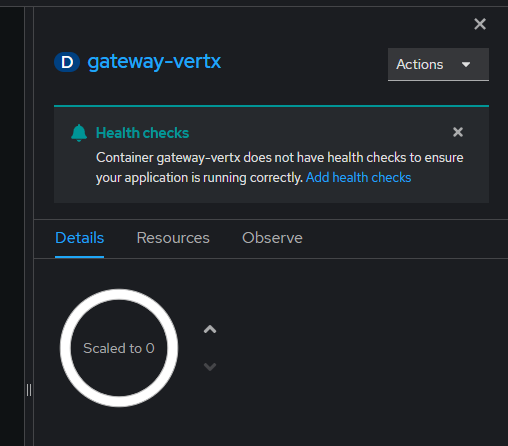

<!-- alignment: center -->

# whoami

<!-- pause -->

```bash +exec
/// whoami() { echo "/maif/dsi/datathèque/TED/omar-hamad"; }
whoami
```

<!-- speaker_note: |
  [0:00 → 0:20]
  - Ctrl+E, laisser le gag
  - (sourire, ne rien dire)
-->

<!-- end_slide -->

# De la donnée, il y en a partout

<!-- pause -->

Batch. Streaming.

<!-- pause -->

ETL. ELT.

<!-- pause -->

Un pont entre deux systèmes.

<!-- pause -->

## Au fond : on déplace et on transforme de la donnée.

<!-- speaker_note: |
  [0:20 → 0:45] ton : chaleureux, calme
  - "plomberie" (sourire)
  - batch / streaming / ETL / ELT : mots différents, même geste
  - déplacer + transformer
  → "plusieurs familles de solutions"
-->

<!-- end_slide -->

# Trois façons de faire
<!--new_lines: 6-->
<!-- column_layout: [1, 1, 1] -->

<!-- column: 0 -->

**Un programme sur mesure**

On garde le contrôle.

Mais il faut tout développer, tester et maintenir.

<!-- pause -->

<!-- column: 1 -->

**Kafka Streams**

Une bibliothèque dans votre application.

Du code JVM, centré sur Kafka.

<!-- pause -->

<!-- column: 2 -->

**Flink, Spark**

Des moteurs de calcul distribués.

Un cluster à exploiter.

<!-- reset_layout -->

<!-- pause -->

Parfois, c'est exactement ce qu'il faut.

<!-- pause -->

Souvent, c'est trop.

<!-- speaker_note: |
  [0:45 → 1:25] ton : respectueux, bref (tu passes vite)
  - sur mesure : on l'a tous écrit, il faut le maintenir
  - Kafka Streams : bibliothèque, pas de cluster, mais du code JVM et Kafka-centré
  - Flink / Spark : niveau au-dessus, cluster à piloter (une phrase, pas plus)
  - (léger sourire) "un camion pour une baguette"
  → "un entre-deux ?"
-->

<!-- end_slide -->

<!-- alignment: center -->

# Et si c'était plus simple ?

<!--new_lines: 10-->

<!-- pause -->

Simple à exploiter.

<!-- pause -->

Facile à faire scaler.

<!-- pause -->

Rien de lourd à porter.

<!-- speaker_note: |
  [1:25 → 1:45] ton : lent, laisser respirer
  - 3 phrases, 3 pauses
  - simple / scaler / léger
  → "Bento"
-->

<!-- end_slide -->

# Bento

<!-- column_layout: [1, 1, 1] -->

<!-- column: 0 -->

**Sources**

- `kafka`
- `file`
- `generate`
- `http_server`
- `sql_select`
- `aws_s3`
- `nats_jetstream`

<!-- pause -->

<!-- column: 1 -->

**Traitements**

- `mapping`
- `branch`
- `http`
- `sql_select`
- `switch`
- `archive`
- `compress`

<!-- pause -->

<!-- column: 2 -->

**Destinations**

- `kafka`
- `sql_insert`
- `elasticsearch`
- `aws_s3`
- `http_client`
- `file`
- `nats_jetstream`

<!-- reset_layout -->

<!-- speaker_note: |
  [1:45 → 2:50] ton : pédagogue, simple
  - 3 blocs : entre / transforme / sort
  - les 7 plus courants de chaque côté (liste partielle, il y en a des dizaines)
  - aujourd'hui : file, sql_select, branch, kafka
  - si question : fork Benthos, MIT, WarpStream
  → "qu'est-ce qui le rend simple ?"
-->

<!-- end_slide -->

# Pourquoi c'est simple
<!--new_lines: 4-->
```bash +exec
du -h "$(command -v bento)"
```

<!-- pause -->

**Un seul binaire.** Rien à installer autour.

<!-- pause -->

**Un fichier YAML.** On décrit, on ne compile pas.

<!-- pause -->

**Sans état.** Une instance de plus, et ça monte en charge.

<!-- pause -->

**Transactionnel.** Acquitté seulement une fois bien livré.

<!-- speaker_note: |
  [2:50 → 3:50] Ctrl+E dès l'arrivée
  - le binaire : un fichier, rien de caché (montrer la taille)
  - YAML : on décrit
  - sans état : s'appuie sur les systèmes reliés → on en lance dix
  - transactionnel : ack après livraison
  - (honnête, regard salle) at-least-once = doublon possible
  → "et chez nous, ça donne quoi ?"
-->

<!-- end_slide -->

# Chez nous, sur OpenShift



<!-- pause -->

Un binaire Go : peu de mémoire au repos, peu de ressources demandées.

<!-- speaker_note: |
  [3:50 → 4:20] ton : factuel, fier sans exagérer
  - montrer la photo : le pod Bento en vrai
  - lire à voix haute ce que montre la photo (mémoire au repos, CPU), pas de chiffre non lu
  - Go : pas de JVM à chauffer, pas de runtime lourd
  - (honnête) c'est un pod, pas un benchmark
  → "voyons-le travailler"
  ! fichier à fournir : assets/openshift.png
-->

<!-- end_slide -->

# Notre terrain de jeu

```bash +exec
docker compose ps --format "table {{.Service}}\t{{.Status}}"
```

```bash +exec
head -4 data/sinistres.csv
```

```bash +exec
docker compose exec -T postgres psql -U bento assurance -c "SELECT * FROM clients LIMIT 4"
```

<!-- speaker_note: |
  [4:20 → 5:00] Ctrl+E ×3, un par un
  - conteneurs : Redpanda, console :8080, Postgres → "rien d'autre"
  - CSV : 2 000 sinistres, juste un client_id
  - clients : les noms sont ici
  - (complice) "retenez la frustration : qui est le client ?"
  - démarré avant (images) : le dire
  → terminal
-->

<!-- end_slide -->

<!-- alignment: center -->

# Un fichier de sinistres
<!--new_lines: 10-->
<!-- pause -->

2 000 lignes, dans un CSV.

<!-- pause -->

Comment les amener dans Kafka ?

<!-- speaker_note: |
  [5:00 → 7:00] terminal — secours : make run P=pont DIR=backup
  gestes :
  - input file + scanner csv → lancer : JSON défile
  - ajouter output kafka (19092, topic sinistres, clé sinistre_id)
  - 2e terminal : make watch TOPIC=sinistres ; console :8080
  preuve : 2 000 messages, pas d'erreur
  (logs de démarrage normaux)
  → "mais... qui est le client ?"
-->

<!-- end_slide -->

<!-- alignment: center -->

# Qui est le client ?
<!--new_lines: 10-->
<!-- pause -->

Un numéro, pas un nom.

<!-- pause -->

Comment l'ajouter à chaque message ?

<!-- speaker_note: |
  [7:00 → 9:15] terminal — secours : make run P=enrichissement DIR=backup
  gestes :
  - rappel : les noms sont dans Postgres (vus sur la slide précédente)
  - partir du pont, ajouter pipeline
  - branch : "chercher ailleurs, rattacher sans écraser"
  - sql_select clients (15432), where client_id
  - topic sinistres-enrichis ; threads: 4
  - make watch TOPIC=sinistres-enrichis
  mots-clés : request_map / result_map / Bloblang ("gauche = droite")
  preuve : le client est dans le message
  → "ça marche. mais peut-on s'y fier ?"
-->

<!-- end_slide -->

<!-- alignment: center -->

# Et si demain, notre client devient sociétaire ?
<!--new_lines: 10-->
<!-- pause -->

Le métier évolue. Le pipeline aussi.

<!-- pause -->

Comment être sûr de ne rien casser ?

<!-- speaker_note: |
  phrase d'accroche (court, posé) : "un test nous évite de déployer un pipeline cassé… mais la logique métier, elle, change"
  [9:15 → 10:45] terminal — test pré-écrit : pipelines/2-enrichissement_bento_test.yaml (secours : make test DIR=backup)
  gestes :
  - cat du test : "Postgres est remplacé par un mock, aucun Docker"
  - make test → vert
  - dans 2-enrichissement.yaml, result_map : root.client → root.societaire
    ("le métier change le mot, le pipeline tourne toujours sans erreur")
  - make test → rouge, message lisible : le champ client a disparu
  - remettre → vert (ou adapter le test si le changement est voulu)
  idée : le test vit à côté du pipeline, tourne en CI → on le sait avant la prod
  (si le mock par chemin échoue : label: lookup_client sur sql_select, clé = label)
  → "et en production, comment on le surveille ?"
-->

<!-- end_slide -->

<!-- alignment: center -->

# Et en production ?
<!--new_lines: 6-->
<!-- pause -->

Est-ce que ça avance ?

<!-- pause -->

Y a-t-il des messages en erreur ? Combien ?

<!-- pause -->

Des métriques utiles, pas du bruit.

<!-- speaker_note: |
  [10:45 → 12:45] ton : confiant, rassurant
  terminal — pipeline indépendant : prod/normalisation.yaml (même idée, sinistres synthétiques)
  fil : "des métriques qui servent, pas du bruit de fond qu'on ignore"
  1. LOGS (0:50) : make prod 2>&1 | jq -c '{niveau: .level, msg, sinistre_id, valide}'
     - "chaque message laisse une trace JSON"
     - option : select(.valide == false) → montants illisibles
     - ATTENTION : traités par le mapping (valide=false), pas perdus, donc PAS comptés
       en erreur (processor_error reste à 0) : c'est voulu, à dire
  2. MÉTRIQUES (1:10), 2e terminal
     - curl -s localhost:4195/ready
     - curl -s localhost:4195/metrics | grep -E '^(input_received|output_sent|output_error|processor_error)'
     - SE CONCENTRER SUR 4 LIGNES (le reste est du bruit, ~80 lignes en tout) :
       · input_received = ce qui entre
       · output_sent = ce qui sort (égal à l'entrée → rien de perdu)
       · output_error, processor_error = COMBIEN de messages en erreur → ici 0
       · (option) processor_latency_ns : _sum ÷ _count = temps moyen ; processeurs en µs, sortie en ms
     - relancer 2 fois : input_received avance → "est-ce que ça avance ? oui"
     - (vraies métriques de prod : 314 reçus = 314 envoyés, 0 erreur)
     - phrase clé : "les compteurs disent COMBIEN, les logs disent LESQUELS"
  → "tout n'est pas rose : voyons les limites"
-->

<!-- end_slide -->

# Pas la solution à tout
<!--new_lines: 2-->
<!-- pause -->

**Peu d'état.** Pas de grosses fenêtres ni de jointures entre flux : un moteur avec état est plus adapté.

<!-- pause -->

**At-least-once.** Un doublon reste possible : la destination doit le supporter.

<!-- pause -->

**Logique métier lourde.** Au-delà du mapping, du vrai code est plus lisible.

<!-- pause -->

**Un langage de plus.** Bloblang est à apprendre, et un YAML peut vite grossir.

<!-- speaker_note: |
  [12:45 → 13:45] ton : honnête, posé (réponse au retour "tu ne dis que du bien")
  - peu d'état : par choix → la simplicité a un prix
  - at-least-once : idempotence côté destination
  - logique lourde : un mapping n'est pas un programme
  - Bloblang + YAML : courbe d'apprentissage réelle
  - "le bon outil pour la plomberie, pas pour tout"
  → "bilan"
-->

<!-- end_slide -->

# Ce qu'on vient d'écrire

```bash +exec
wc -l pipelines/*.yaml
```

<!-- pause -->

**Deux pipelines, un test.** Des logs et des métriques en prime.

<!-- pause -->

Pas de programme à maintenir. Pas de cluster à exploiter.

<!-- speaker_note: |
  [13:45 → 14:05] Ctrl+E
  - wc -l pipelines : ce qu'on a écrit ensemble
  - plomberie du quotidien : très bon choix
  → "questions"
-->

<!-- end_slide -->

<!-- alignment: center -->

# Questions ?

<!-- pause -->

## Merci !

Docs : https://warpstreamlabs.github.io/bento

GitHub : warpstreamlabs/bento


<!-- speaker_note: |
  [14:05 → 15:00] ton : souriant (marge : tu dépasses d'environ 2 min en vrai)
  - merci
  - rejouer : make up + un binaire
  - MIT, contributions bienvenues
  - (ouvert) questions
-->
