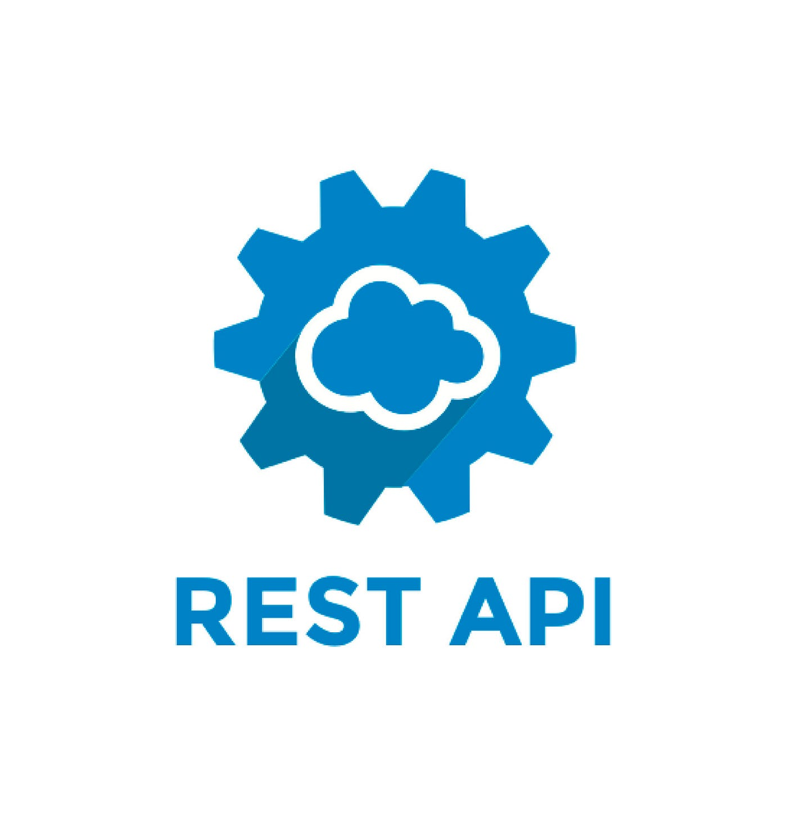
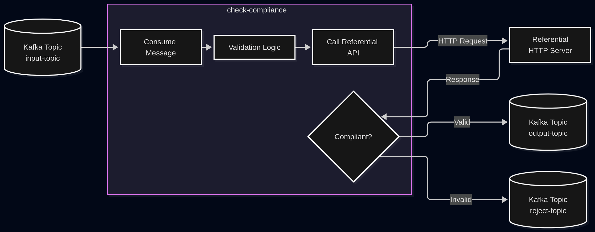
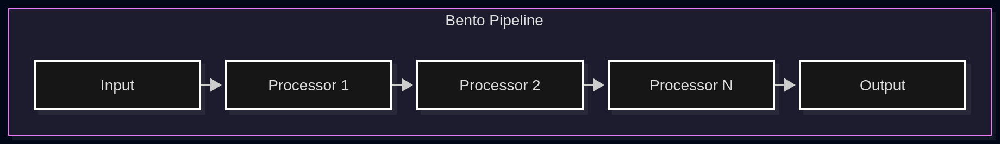

<!-- alignment: center -->
<!-- font_size: 1 -->
# whoami


<!-- pause -->


<!--end_slide-->
<!-- alignment: center -->
# whoami

```bash +exec
/// whoami() { echo "/maif/dsi/datathèque/TED/omar-hamad"; }
whoami
```

<!-- end_slide -->

# Un pipeline, c'est quoi ?

De la donnée qui va d'un **point A** vers un **point B**, des sources et des sinks

<!-- pause -->

**La source** peut être...

<!-- pause -->


<!-- pause -->


<!-- pause -->


<!-- pause -->



<!-- pause -->

**La destination** peut être...

<!-- pause -->


<!-- pause -->


<!-- pause -->


<!-- pause -->


<!-- speaker_note: TODO -->

<!-- end_slide -->

# C'est le voyage, pas la destination

<!-- pause -->
<!-- new_line -->
<!-- new_line -->
<!-- new_line -->



<!-- end_slide -->

# Le biais du développeur

<!-- pause -->

On pense naturellement aux erreurs métier.

_« Cet utilisateur existe-t-il ? »_

<!-- pause -->

Mais les dépendances peuvent aussi échouer.

DNS. Timeout. Réseau. Service indisponible.

<!-- pause -->

## Une erreur technique peut changer le destin de tout un flow

<!-- speaker_note: TODO -->

<!-- end_slide -->

# Le scénario Kafka

Un batch de **20 messages**.

<!-- pause -->

Chaque message déclenche un appel HTTP externe.

<!-- pause -->

19 appels réussissent.

<!-- pause -->

Le 20ᵉ échoue : le service est indisponible.

<!-- pause -->

## Qu'est-ce qui a été confirmé ? Qu'est-ce qui doit être rejoué ?

<!-- speaker_note: TODO -->

<!-- end_slide -->

# Le piège : confondre échec et succès partiel

```go {all|2|3|7|9}
func processBatch(messages []kafka.Message) error {
    for _, msg := range messages {
        resp, err := httpClient.Post(enrichURL, msg.Body)
        if err != nil {
            return err
        }
        producer.Write(msg, resp)
    }
    return consumer.CommitBatch(messages)
}
```
<!--pause-->
À première vue :

✅ si une erreur survient, on retourne une erreur
<!--new_line-->
✅ si tout se passe bien, on commit le batch

<!-- pause -->
Mais ..
<!-- pause -->
❌ Si le commit porte sur le batch entier, l'échec du dernier appel peut entraîner le rejeu des messages précédents.

<!-- pause -->

**Conséquence possible :** travail répété, effets de bord dupliqués, progression bloquée.

<!-- speaker_note: TODO -->

<!-- end_slide -->

# Que devrait-on gérer à la main ?

<!-- pause -->

Les règles métier.

<!-- pause -->

Les transformations propres au domaine.

<!-- pause -->

Les choix explicites de reprise, de fallback et de DLQ.

<!-- pause -->

## Pas toute la plomberie du flux.

<!-- end_slide -->

<!-- alignment: center -->

# Démo 1

<!-- speaker_note: TODO -->

<!-- end_slide -->

# Le pipeline tient en quelques blocs

```yaml
input:
  kafka:
    addresses: ["${KAFKA_BROKERS:localhost:19092}"]
    topics: ["orders"]
    consumer_group: "bento-presenterm-demo"
    checkpoint_limit: 16

pipeline:
  processors:
    - mapping: |
        root = this
        root.demo_processed = true
        root.processed_at = now()

output:
  kafka:
    addresses: ["${KAFKA_BROKERS:localhost:19092}"]
    topic: "orders-processed"
    key: '${! json("order_id") }'
```

<!-- pause -->

La configuration décrit le flux ; le runtime exécute les composants et applique leurs mécanismes de traitement.

<!-- speaker_note: TODO -->

<!-- end_slide -->
<!-- newlines: 10-->


<!--end_slide-->

# Ce que Bento prend en charge

<!-- pause -->

**Le transport** : lire et écrire via les composants configurés.

<!-- pause -->

**Le flux** : limiter le travail en cours et appliquer la backpressure.

<!-- pause -->

**Les erreurs** : propager les échecs et appliquer la stratégie configurée.

<!-- pause -->

Pour répondre à la question posée tout à l'heure : le commit du consumer suit le composant input, pas un minuteur séparé — un message n'est acquitté qu'une fois sorti du pipeline. Le détail exact (par message ou par batch) dépend du composant et de sa configuration.

<!-- speaker_note: TODO -->

<!-- end_slide -->

<!-- alignment: center -->

# Démo 2

<!-- speaker_note: TODO -->

<!-- end_slide -->

# Un fallback d'output

```yaml
output:
  fallback:
    - kafka:
        addresses: ["${KAFKA_BROKERS:localhost:19092}"]
        topic: "orders-processed"
    - kafka:
        addresses: ["${KAFKA_BROKERS:localhost:19092}"]
        topic: "orders-dlq"
```

<!-- pause -->

La seconde sortie est une solution de repli si la première échoue.

<!-- pause -->

## Une DLQ n'est pas une stratégie de retry universelle.

<!-- speaker_note: TODO -->

<!-- end_slide -->

# Et l'enrichissement HTTP du scénario Kafka ?

<!-- pause -->

Une API nominale peut tomber, exactement comme dans l'exemple Go.

<!-- pause -->

On peut définir un fallback applicatif : source secondaire, valeur par défaut ou échec contrôlé.

<!-- pause -->

Mais il faut distinguer cet enchaînement du fallback d'output vu à l'instant.

<!-- pause -->

## Annoncé en introduction : cette partie reste illustrative, pas démontrée en direct.

<!-- speaker_note: TODO -->

<!-- end_slide -->

# Un YAML, ça se teste ?

<!-- pause -->

Oui : la configuration peut être versionnée et validée.

<!-- pause -->

`bento lint` détecte les erreurs de configuration.

<!-- pause -->

`bento test` exécute des tests sur des processeurs ciblés.

<!-- pause -->

## Ce n'est pas un test d'intégration du broker.

<!-- speaker_note: TODO -->

<!-- end_slide -->

# Un test de transformation

```yaml
tests:
  - name: adds demo marker and timestamp
    target_processors: "/pipeline/processors"
    input_batch:
      - json_content:
          order_id: 101
          customer_id: 42
          total: 29.9
    output_batches:
      - - json_equals:
            order_id: 101
            customer_id: 42
            total: 29.9
            demo_processed: true
```

<!-- pause -->

Le test est versionné à côté du pipeline et peut tourner en CI.

<!-- speaker_note: TODO -->

<!-- end_slide -->

# De la démo à la CI

```sh
bento lint pipelines/01-kafka-to-processed.yaml
bento test tests/01-kafka-to-processed_bento_test.yaml
```

<!-- pause -->

Un pipeline déclaratif peut être relu, contrôlé et testé avant déploiement.

<!-- pause -->

La CI ne remplace pas les tests d'intégration ni l'observabilité en production.

<!-- speaker_note: TODO -->

<!-- end_slide -->

# L'observabilité fait partie du système

<!-- pause -->

Métriques, logs et traces doivent aider à répondre à trois questions :

<!-- pause -->

**Est-ce que ça avance ?**

<!-- pause -->

**Où est-ce que ça ralentit ?**

<!-- pause -->

**Pourquoi ce message est-il en échec ?**

<!-- speaker_note: TODO -->

<!-- end_slide -->

# À retenir

<!-- pause -->

- Un pipeline, ce n'est pas seulement A → B : c'est aussi la transformation et les échecs.

<!-- pause -->

- Backpressure et données en vol influencent la stabilité du flux.

<!-- pause -->

- Bento rend la configuration explicite et réutilisable.

<!-- pause -->

- Retries, fallback et DLQ doivent correspondre au comportement souhaité.

<!-- pause -->

- Lint, tests et observabilité complètent la configuration.

<!-- speaker_note: TODO -->

<!-- end_slide -->

<!-- alignment: center -->

# Questions ?

<!-- pause -->

## Merci !

Docs : https://warpstreamlabs.github.io/bento

GitHub : warpstreamlabs/bento
